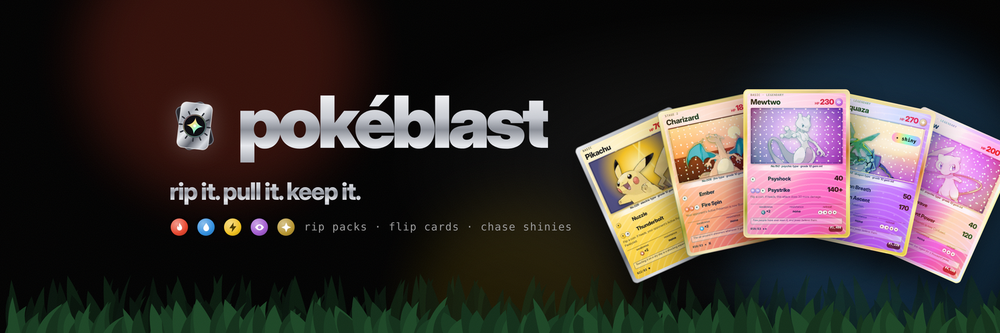

# pokéblast

**rip it. pull it. keep it.**

pokéblast is a Pokémon card pack-opening simulator. Rip foil packs, flip five cards, chase shinies and gem mint 10s, catch wild Pokémon in the tall grass, fill your Pokédex, and build a graded vault.

## Features

- **Three foil packs:** Route 1, Elite and Mythic, each with its own odds, expected value and a guaranteed rare-or-better last card.
- **Pack opening:** the pack shakes, the top tears off, and the color of the light hints at your best card. Rare cards glow before you flip them.
- **Trading cards:** every card has HP, two attacks with energy costs, weakness, resistance, retreat cost, flavor text and a type-themed background.
- **Six rarity tiers:** common, uncommon, rare, holo rare, legendary and mythic, plus a 1-in-20 shiny chance.
- **Grading:** every card is graded 7 to 10 and priced from its tier, grade and shininess.
- **Wild encounters:** Pokémon appear in the corner with a retro text box. Catch them to add them to your vault.
- **Pokédex:** all 83 Pokémon as silhouettes that light up when you find them.
- **Vault:** inspect cards with a holo tilt effect, or sell them back for 60%.
- **Music and sound:** an original chiptune soundtrack and sound effects, made with the Web Audio API.

## Running it

It's a single `index.html` file with no build step and no dependencies. Open it in a browser, or visit the GitHub Pages site.

## Credits

Fan-made school project. Not affiliated with or endorsed by Nintendo, Game Freak, Creatures or The Pokémon Company. Pokémon names and artwork belong to their owners. Artwork via [PokeAPI](https://pokeapi.co/). ₽ is play money.

Follow on X: [@UsePokeblast](https://x.com/UsePokeblast)
